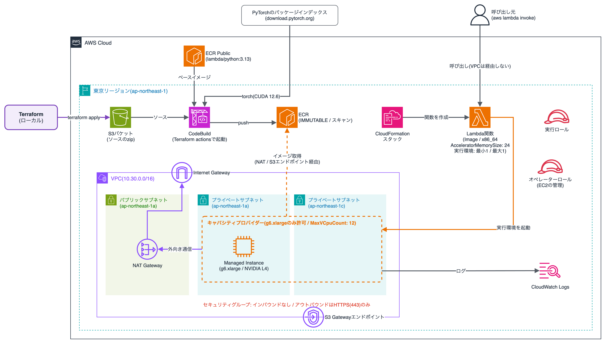

# Lambda Managed InstancesのGPU検証環境

2026/11/16に追加されたLambda Managed Instances(LMI)のGPU対応(`AcceleratorConfig`)を検証するための環境です。

## 構成



- `app/`: GPU関数のコンテナイメージ(PyTorchで行列積をCPUとGPUで比較する)
- `terraform/`: VPC、ECR、CodeBuild、キャパシティプロバイダー、GPU関数
- `docs/`: 構成図(`.drawio`はdraw.ioで編集できる元ファイル)

コンテナイメージはCodeBuildでビルドし、Terraform actions(`aws_codebuild_start_build`)から起動します。ローカルにDockerは不要です。

GPU関数はAWS Provider / AWS CC Providerが`AcceleratorConfig`に未対応のため、`aws_cloudformation_stack`経由で作成しています。

## 前提

- Terraform 1.14以上(Terraform actionsを使うため)
- us-east-1の「Running On-Demand G and VT instances」クォータ(既定の3台構成ならg6.xlarge×3で12 vCPU以上)

## 手順

リージョンや台数を変える場合は、`terraform/terraform.tfvars.example`をコピーして`terraform/terraform.tfvars`を作成してください。

```bash
cd terraform
terraform init

# 1. VPC・ECR・CodeBuild・キャパシティプロバイダーを作成し、イメージをビルドする
#    (GPUインスタンスはまだ起動しない)
terraform apply

# 2. GPUクォータの承認後、関数を作成する(ここでGPUインスタンスが起動する)
terraform apply -var deploy_function=true

# 3. 呼び出す
aws lambda invoke --region us-east-1 \
  --function-name "$(terraform output -raw function_name)" \
  --qualifier '$LATEST.PUBLISHED' \
  --cli-binary-format raw-in-base64-out \
  --payload '{"size": 4096, "repeat": 10}' response.json
cat response.json

# 4. 片付け
terraform destroy -var deploy_function=true
```

## 依存パッケージのロック

`app/requirements.txt`は、`app/pyproject.toml`からuvで生成したハッシュ付きのロックです。
torch本体はPyTorchのCUDA 12.6版ホイールをURLとハッシュで固定し、依存パッケージはPyPIから解決しています。
公開直後のパッケージを避けるため、公開から7日以上経った版だけを使います。

```bash
cd app
uv pip compile pyproject.toml --generate-hashes \
  --python-version 3.13 --python-platform x86_64-manylinux_2_28 \
  --only-binary :all: --exclude-newer "7 days" \
  --no-header --no-annotate -o requirements.txt
```

## セキュリティ上の割り切り

検証用の短期間の環境として、次の点は割り切っています。

- ログ・ECR・S3の暗号化はAWS管理のキー(KMSのカスタマー管理キーは使わない)
- VPCフローログ、S3アクセスログは取得しない
- CodeBuildはdocker buildのため特権モードで動かす
- Managed Instancesのアウトバウンドは443番ポートを0.0.0.0/0へ許可(宛先は絞っていない)
- ECRの基本スキャンはOSパッケージのみが対象(Pythonパッケージは見ない)

## 費用の目安(us-east-1)

- 手順1の後: NATゲートウェイ 約$0.045/時、CodeBuild 1回あたり十数分(BUILD_GENERAL1_MEDIUM)
- 手順2の後: g6.xlarge($0.8048/時)×3台 + 管理料15% = 約$2.78/時
